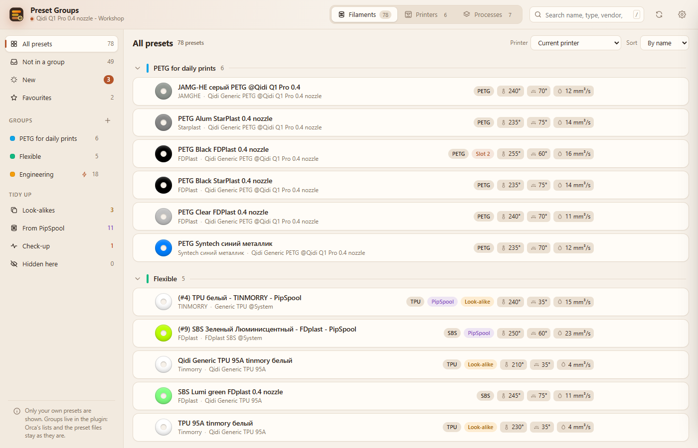
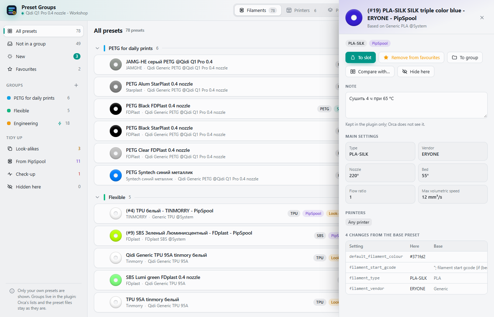
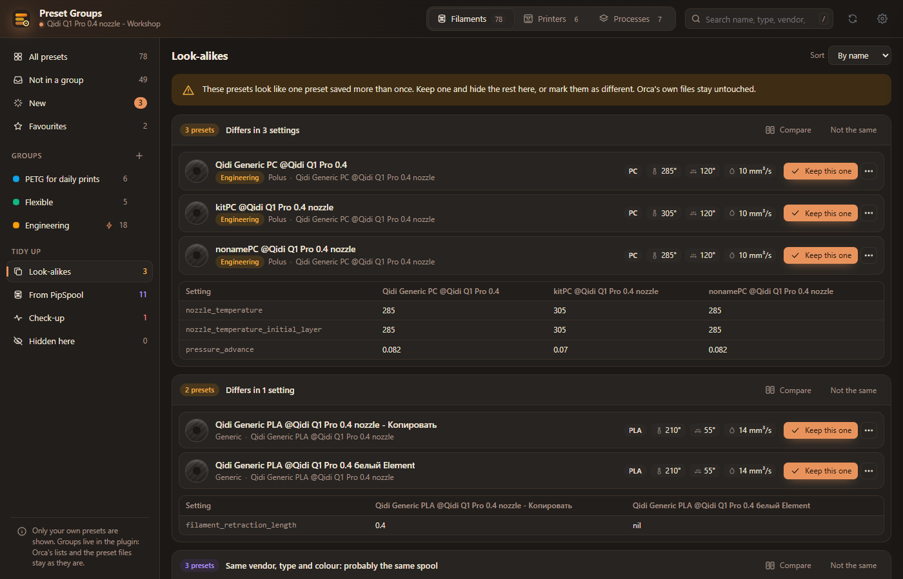

# Preset Groups for OrcaSlicer

An OrcaSlicer 2.5 plugin that sorts **your own** presets (filaments, printers, processes) into
groups with any names, finds the ones saved more than once and keeps them tidy. System and Generic
presets are left out.



- **Groups with any name and colour.** Drag presets onto a group, or select several (click the
  checkbox, Shift for a range, Ctrl+A for all) and press *To group*. Groups are kept per kind and
  can be reordered, renamed, collapsed and deleted; every move can be undone.
- **Groups that fill themselves.** Give a group a rule (type, vendor, printer, printer model, part
  of the name; commas mean "any of") and matching presets go into it by themselves, new ones too.
  Presets put into a group by hand stay there; one taken out by hand is not put back.
- **New presets.** Presets that appear later (saved in Orca, made by PipSpool or by another app)
  are marked *New* and have their own view until you put them away.
- **Per printer.** By default only presets for the current printer are shown; the *Printer* filter
  switches to all printers or one model.
- **Look-alikes.** Presets with identical settings, presets of the same base that differ in up to
  four settings, and PipSpool presets that match an own preset by vendor, type and colour.
  Filaments of different colours never count. *Keep this one* hides the others in the plugin,
  *Not the same* dismisses the cluster.
- **Check-up.** Presets whose base preset is gone, and presets made only for printers you no longer
  have (Orca then offers them for no printer).
- **Compare.** Any two to four presets side by side, only the settings that differ, with a filter.
- **Load into slots.** Put a filament into a slot, or load a whole group or a selection into the
  filament slots at once; a filament already in a slot stays there. *Select* switches the printer
  or process. If the edited preset has unsaved changes, the plugin asks you to save them first
  instead of opening Orca's dialog.
- **Favourites and notes.** Star a preset to keep it on top; write a note to it ("dry 4 h at 65 °C").
- **Backup.** Export the plugin's settings to a file or text and import them on another computer or
  account (add to yours, or replace them). Presets are matched by name.
- **Themes.** As in Orca, *Warm* and *Dark*. English and Russian.

| Details and changes from the base preset | Look-alikes, dark theme |
| --- | --- |
|  |  |

## What it does not do

The plugin reads presets through Orca's API (`orca.host.preset_bundle()`) and never opens or
writes preset files, so names in any script are safe. Groups, rules, favourites, notes and hidden
presets live in the plugin's settings: Orca's own preset lists do not change, and *Hide here* only
hides a preset in the plugin. The plugin uses no network.

## Install

Download `presetgroups-<version>-py3-none-any.whl` from the
[releases](https://github.com/GNUGiminot/preset-groups-orcaslicer/releases) and install it in
OrcaSlicer 2.5 from the plugin manager (*Install from file*).

## Build and test

```
python -m unittest discover -s tests
python build_wheel.py
```

`build_wheel.py` joins `presetgroups.py`, `presetgroups_core.py` and `page.html` into one module and
writes `dist/presetgroups-<version>-py3-none-any.whl`. The tests run the plugin against a fake
`orca` module, and the part of the page between `PURE:BEGIN` and `PURE:END` (group rules, import)
in Node.js when it is installed.

## License

MIT, see [LICENSE](LICENSE).
